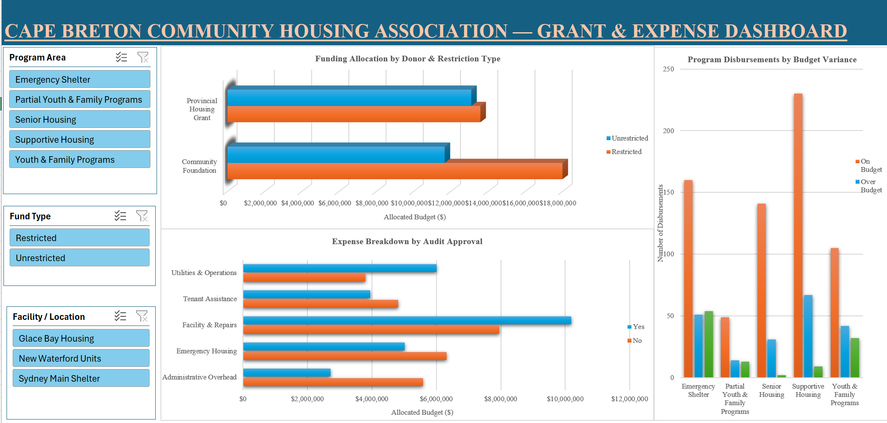

# Cape-Breton-Housing-Finance-Dashboard
Interactive Excel financial management &amp; grant-tracking dashboard for non-profit housing operations
# Cape Breton Community Housing Association — Grant & Expense Dashboard

## 📌 Project Overview
An interactive financial management and grant-tracking Excel dashboard built for non-profit housing operations. This tool processes 1,000+ disbursement records across regional housing facilities (Sydney, Glace Bay, New Waterford) to provide real-time visibility into donor funding restrictions, operational expense compliance, and program budget variances.

## 🛠️ Key Technical Features
* **General Ledger Data Modeling:** Structured raw financial transactions into clean relational tables with standardized expense categories, funding sources, and audit flags.
* **Multi-Dimensional Pivot Engine:** Formatted custom Pivot Tables to calculate restricted vs. unrestricted donor allocations, compliance approval ratios, and program variance distributions.
* **Interactive Executive Dashboard:** Designed a gridless front-end UI featuring cross-filtered Slicers (`Program Area`, `Fund Type`, `Facility / Location`) for real-time scenario filtering.

## 📊 Dashboard Insights
1. **Grant Funding Stream Analysis:** Evaluates funding distribution between Provincial Grants and Community Foundations, highlighting restricted fund obligations.
2. **Expense & Compliance Audit:** Tracks operational spend across Facility Repairs, Emergency Housing, Utilities, and Tenant Assistance against audit approval statuses.
3. **Program Variance Tracking:** Identifies budget performance across housing programs (Supportive Housing, Emergency Shelter, Senior Housing, Youth & Family) to prevent cost overruns.
